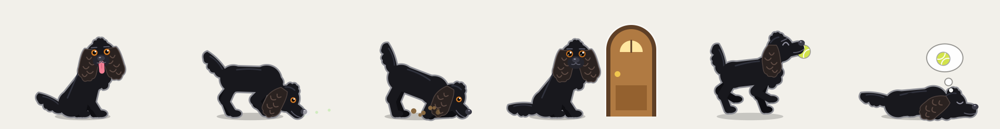

# elvis

<picture>
  <source media="(prefers-color-scheme: dark)" srcset="docs/elvis-dark.png">
  
</picture>

i miss my best mate. so i built him a spot in the corner of my screen.
elvis is a small black sprocker who lives above the Dock and reacts to whatever Claude Code is doing. he’s eager, he wants you to be pleased with him, and he’s not very bright.

he draws in a transparent strip and never takes focus. clicks pass straight through everywhere except on elvis himself.

## get him

you need macOS 14 or later and Claude Code. nothing to build.

```sh
claude plugin marketplace add j4ckwinter/elvis#release
claude plugin install elvis@elvis
```

start or resume a Claude Code session and he wakes up. that includes headless `claude -p` runs; set `ELVIS_AUTOSTART=0` if you’d rather he slept through those.

when the plugin updates, the next session you start swaps him for the new build. `ELVIS_AUTOSTART=0` turns that off too.

GitHub Actions builds each `v*` tag into a universal binary and publishes it with the plugin on the `release` branch. the install was tested on Apple silicon for 0.2.0; the Intel half has only printed its help under Rosetta. want to build him instead? see [build him yourself](#build-him-yourself).

## say hello

press on him and drag to pick him up. carry him anywhere on any display and let go. he lives there until you move him again. a click without a drag is a pat, and moving the pointer over him is a stroke.

the paw print in the menu bar says what he thinks he’s doing. it counts the Claude Code sessions that are working or waiting for you and the subagents they have out. it also throws a ball, turns sounds off, moves him between corners, shows his version, and quits. **Back to His Corner** sends him home.

`elvis status` asks him the same thing from a terminal, and adds his version and how long ago he last heard from Claude Code. it’s the quick way to tell whether he’s hearing your session.

for the tour without Claude, run `elvis demo`. it walks through his reactions in about 85 seconds. each [release](https://github.com/j4ckwinter/elvis/releases) has the binary as a zip for that. macOS quarantines a browser download, so clear it first with `xattr -d com.apple.quarantine elvis`.

## what he does

| when | elvis |
| --- | --- |
| nothing is happening | sits about, then lies down, dozes, and after about four minutes falls asleep. |
| you send a prompt | startles awake and bounds up. |
| Claude reads and searches | follows a scent trail, nose down, ears dragging. |
| Claude edits files | digs, which is where the mud comes from. |
| Claude runs a command | points at it, one paw up. |
| Claude searches the web | sniffs the air. |
| Claude sends out subagents | stops and cocks his head one way, then the other. he keeps an ear out until they’re back. |
| tests fail | sits, ears down, and whines softly, at most once every 90 seconds. |
| tests pass | chases a ball, trots it back, and sits there looking proud. one fetch per 45 seconds; otherwise a wag. a pass straight after a failure gets a spin and a yip first. |
| Claude commits | buries a bone where it will be safe. one bone per 20 seconds. |
| Claude pushes | barks twice to tell the whole street. one bark a minute; otherwise a wag. |
| Claude needs your approval or an answer | goes to the door, sits, and stares at you. he tilts his head, paws the door, and after a couple of minutes lies down with his chin on the floor. he stays silent while he waits. |
| you answer | a relieved hop, then back to work. |
| a run of two minutes or more ends | flops flat out, tongue out, tail thumping. |
| a shorter run ends | trots over and wags at you. |

left alone he scratches, sneezes, stretches, chases his tail and regrets it, circles before lying down, twitches and dreams of tennis balls in his sleep, and nudges the ball toward you in case you missed it. mud builds up through the day as Claude edits. he shakes it off when things go quiet, and he starts each day clean.

## your own tests, commits, and pushes

elvis can also react to tests you run yourself in zsh or bash, and to your own `git commit` and `git push`. add this to `~/.zshrc`:

```sh
eval "$(/path/to/elvis shell-init zsh)"
```

or this to `~/.bash_profile`, which is the file bash reads in a macOS terminal:

```sh
eval "$(/path/to/elvis shell-init bash)"
```

it reports each finished command’s exit status to elvis, who ignores everything that isn’t a test run, a commit, or a push. when a pipe hides the exit status, as in `npm test | tail` or `git push | cat`, he stays out of it rather than guess. he does the same when a chain such as `cd app && npm test` fails, because the status could belong to either command.

bash has no hook that hands over the line you typed, so there he reads it from the shell’s history and checks it against the command bash is about to run. he stays out of anything typed through an alias, behind `time`, or kept out of history with a leading space. if another tool already holds bash’s `DEBUG` trap he says so once and leaves it alone. checked with the bash 3.2 that ships with macOS.

## what leaves the hook

the hook reads Claude Code’s payload and reduces it to an event name, the session id, a broad tool category, the id Claude Code gave a subagent, and a hash that pairs a permission request with its tool call. it writes that to a Unix socket in `~/Library/Application Support/Elvis/`. prompts, commands, file paths, and tool output go no further than the hook process. the hooks are asynchronous, print nothing, and always exit 0.

`elvis status` gets back only what the menu shows, his version, and how long ago he last heard from Claude Code.

`state.json` in the same directory holds the day’s mud, the two menu settings, and where you last put him down. `elvis.lock` holds the version and process id of the elvis who is running.

## build him yourself

you need the Swift toolchain, from Xcode or the Command Line Tools.

```sh
git clone https://github.com/j4ckwinter/elvis.git
cd elvis
make                      # builds him and copies the binary to plugin/bin/elvis
plugin/bin/elvis start
plugin/bin/elvis demo
```

`plugin/` is the Claude Code plugin. its hooks run `plugin/bin/elvis hook`, so build first. the `main` branch carries no binary, and installed from there the hooks do nothing until you run `make`.

to try him for one session:

```sh
claude --plugin-dir /path/to/elvis/plugin
```

to keep him, add the checkout as a local marketplace and install from it:

```sh
claude plugin marketplace add /path/to/elvis
claude plugin install elvis@elvis
```

Claude Code reads a plugin from a local marketplace in place, so keep the folder around. its hooks run `plugin/bin/elvis` from the checkout, and a later `make` changes them at once. checked on 12 November 2026 with Claude Code 2.1.322.

the elvis on screen keeps running the build he was started from. `make restart` rebuilds and swaps him. `make install` puts `elvis` on your `PATH` by linking `~/.local/bin/elvis` to the same build, and `elvis version` says which version a build is.

to work on him:

```sh
make test           # logic, hook translation, test-run detection, a drawing smoke test, and the built binary
make sheets         # renders every pose to sheets/poses-dark.png and sheets/poses-light.png
make claude-check   # has a real Claude Code session commit and push, and checks he would hear of both
ELVIS_HOME="$(mktemp -d)" ELVIS_FILM=/some/dir .build/release/elvis run   # films a second elvis as contact sheets
```

[AGENTS.md](AGENTS.md) has the working rules, which file owns which decision, and how a release goes out.

## a bit more

<details>
<summary>known limits</summary>

- in a full-screen Space he stays where the top of the Dock would be. checked by eye on 12 November 2026.
- he starts on the primary display. dragging him is the only way to move him to another one.
- while he’s resting the app checks the pointer ten times a second, so a very fast click on him can pass through to the window underneath.
- with “Displays have separate Spaces” on, he may disappear briefly while he’s carried across two displays. not checked.
- Claude Code reports nothing at the moment you approve a command, so he stays by the door until that command finishes. this is also why he never whines there.
- when a chain such as `npm run build && npm test` fails, he blames the tests only if the output reports failing tests. after nothing but a `cd`, any failure is the runner’s, unless the output shows the `cd` itself failed. your own shell passes him no output, so there a failed chain goes unremarked.
- the menu counts sessions and subagents but can’t name them. project names and paths stay inside the hook.
- only a commit and a push count as saving and sending work. a merge, a rebase, or `gh pr create` goes unremarked.
- he hears about Claude’s commits and pushes from Claude Code itself, which marks the result of a command that committed or pushed. seen in Claude Code 2.1.322 and 2.1.323. a version that doesn’t mark them leaves him unaware, and `make claude-check` tells you whether yours does.
- in your own shell he sees the command and its exit status but no output, so a `git push` with nothing to send still gets a bark.
- the shell integration covers zsh and bash. fish isn’t supported.
- test detection is a list of known runners. an unusual runner goes unnoticed until it’s added to `TestRuns.swift`.
- a session start swaps him only for a newer version. two builds of the same version look alike to the hook, so after rebuilding from source run `make restart`.

</details>

MIT licensed. see [LICENSE](LICENSE).
